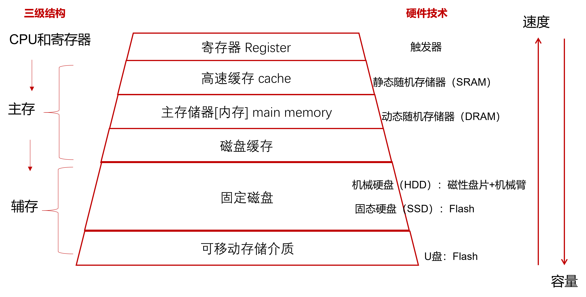
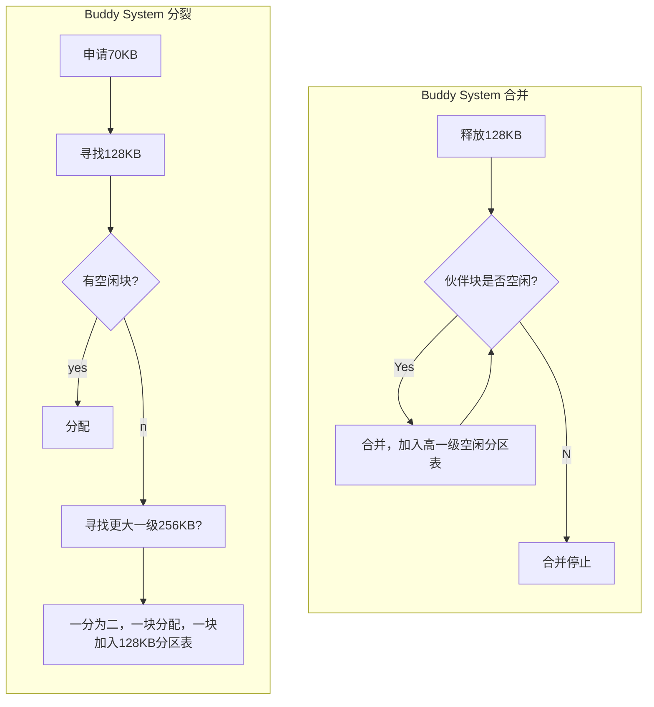
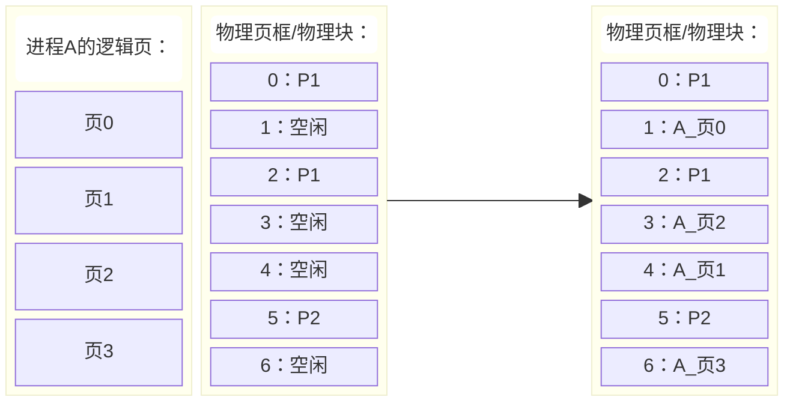

## 第四章  内存管理
*XSUN@GZHU
2026/10/14*

通过前几章的学习，我们知道操作系统能够创建多个进程，使用PCB记录进程状态，并通过调度算法决定哪个进程使用CPU。虽然CPU只有一个，但多个程序可以通过轮流执行表现出同时运行的效果。

那么问题来了：CPU可以轮流使用，**内存 Main Memory**又该怎么办？

要回答这个问题，首先让我们回忆一下计算机存储器的层次结构:



如上图，其采用三级结构，速度和容量存在着不可兼得的关系。我们这一章所关注的是内存(或者称为主存)的管理。

了解了内存在计算机系统所扮演的角色，我们还需要知道：所谓进程需要内存空间究竟是什么意思？也就是问：

**一个磁盘上的可执行程序，究竟是如何变成内存中的指令和数据，并被CPU执行的？**

### 程序装载
简单来说，以如下汇编程序为例：
```nasm
;calculate a + b
LOAD a
ADD b
a:2
b:3
```
其中：
- `LOAD`:从内存读取数据, 后跟数据所在内存地址，机器码是`0x01`
- `ADD`:将内存的数据与`ax`相加, 后根数据所在内存地址，机器码是`0x02`

那么，经过汇编器后得到计算机可以识别的机器码：
```
0x01 0x04 0x02 0x05 0x02 0x03
```
把这些数据加载到内存中，加载的动作早期有人工手动方式向内存中写数据，有了操作系统之后由操作系统完成。假定就从内存地址0处开始加载：
```
地址        数据
0x00        0x01
0x01        0x04
0x02        0x02
0x03        0x05
0x04        0x02
0x05        0x03
```
如此，内存中这最开始的`6B`数据就是该进程在内存中的映像。

如果此时，有另一个程序：
```nasm
;calculate a + 1
LOAD a
INC
a:2
```
其编译后（假定`INC`指令使`ax`自增1，机器码为`0x03`）：
```
0x01 0x03 0x03 0x02
```
也需要装载到内存中，则只能从地址`0x06`开始，且此时标签变量`a`的物理地址就会发生变化，才能保证原程序的正确语义：
```
0x06        0x01
0x07        (0x03) -> (0x09)
0x08        0x02
0x09        0x03
```
`a`的内存地址的变换过程称之为**地址重定位**：一个使程序地址对应到实际内存位置的过程。在本例中，`a`的物理地址的计算：

```math
物理地址 = 基址 + 程序内偏移地址
```
注意，以上模型只是帮大家建立内存管理的直觉，在不同体系结构和装载方式下，地址绑定机制可以不同，现代Linux程序通常采用更复杂的虚拟地址转换机制。

由上例可知，操作系统内存管理的三个基本任务：
- 分配与回收：谁可以使用哪部分内存？
- 地址转换：程序使用的地址如何对应物理位置？
- 内存保护：如何避免进程互相干扰？

### 单一连续
在早期的批处理系统中，内存管理非常简单，首先管理系统本身会占据内存的一部分，然后剩下的部分只能允许一个用户程序占据，这种方式就是单一连续内存分配，如某系统OS占有16K，给用户进程的大小是48KB：
```
0x00000000→---------------+
          |   OS (16K)    |
0x00004000→---------------+
          |               |
          |  USER (48K)   |
          |               |
0x00010000→---------------+
```
对于单一连续分配，如果：
1. 用户程序A只占用10KB，剩余38KB怎么办？
2. 程序A等待键盘输入，CPU暂时没有工作，能不能执行程序B？
3. 若把A从内存中移走，再装入B，有没有代价？

CPU上下文切换与程序内容的换入换出不是同一种成本。前者需要保存/恢复执行上下文，后者可能涉及大量数据传输。

单一连续分配简单，管理开销小，但不适合支持多个用户进程同时驻留内存。

既然可以划出一个用户区，为什么不能将它进一步划成多个分区？

### 固定分区
为了支持多个用户进程，我们可以把之前给USER的48KB分成3个大小为16KB的固定分区：
```
0x00000000→---------------+
          |   OS (16K)    |
0x00004000→---------------+
          |   U1 (16K)    |
0x00008000→---------------+
          |   U2 (16K)    |
0x0000c000→---------------+
          |   U3 (16K)    |
0x00010000→---------------+
```
如此，可让分别进入不同分区，配合进程调度，让多个程序交替运行。此时操作系统需要用一个**分区表**来维护分区状态：
```c
typedef struct entry{
    int start_addr;
    int size;
    bool free;
}entry;

entry partition_table[3];
```
需要知道各个分区的起始地址，大小、是否已被分配等信息。

若此时A(2K)、B(8K)、C(15K)三个进程被装入内存，我们看一下各分区的占用情况：
```
0x00004000                           0x00008000
     +--------------------------------+
    A|■■■■                            |(16K)
     +--------------------------------+
0x00008000                           0x0000c000
     +--------------------------------+
    B|■■■■■■■■■■■■■■■■                |(16K)
     +--------------------------------+
0x0000c000                           0x00010000
     +--------------------------------+
    C|■■■■■■■■■■■■■■■■■■■■■■■■■■■■    |(16K)
     +--------------------------------+
```

计算一下总体内存利用率: $(2+8+15)/48\approx52\%$，而且剩下未使用的 $48-25=23\mathrm{KB}$ 的空间也无法分配给其他进程了。这23KB的空间是由三个分区剩余的空间组成的，这些剩余的空间称为**内部碎片**。此外，若C进程需要22KB的内存，都无法被装入而运行。

一种改善方法是采用空间大小不同的分区，比如：
```
0x00000000→---------------+
          |               |
          |               |
          |   OS (16K)    |
          |               |
0x00004000→---------------+
          |    U1 (4K)    |
0x00005000→---------------+
          |               |
          |    U2 (8K)    |
0x00007000→---------------+
          |               |
          |   U3 (12K)    |
          |               |
0x0000a000→---------------+
          |               |
          |               |
          |               |
          |   U4 (24K)    |
          |               |
          |               |
0x00010000→---------------+
```
这样，不仅可以按匹配大小装入ABC进程，而留出了一个分区：
```
0x00004000   0x00005000
     +--------+
    A|■■■■    |(4K)
     +--------+
0x00005000           0x00007000
     +----------------+
    B|■■■■■■■■■■■■■■■■|(8K)
     +----------------+
0x00007000                   0x0000a000
     +------------------------+
   U3|                        |(12K)
     +------------------------+
0x0000a000                                           0x00010000
     +------------------------------------------------+
    C|■■■■■■■■■■■■■■■■■■■■■■■■■■■■■■■■■■■■■■■■■■■■    |(24K)
     +------------------------------------------------+
```
但是，内部碎片的问题仍热无法得到根本改善！怎么办呢？

其实内部碎片产生的本质原因就是分区是固定的，因此我们动态地改变分区的大小。

### 动态分区
所谓动态分区，就是不事先对内存进行分区，由程序载入和换出动态地决定新来的进程分配到哪一块空闲区。因此，系统需要一个**空闲分区表**来实时地记录空闲区域的状态，比如：

|大小|起始地址|
|--|--|
|10K|0x5000|
|5K|0x7000|
|30K|0x12000|

那么，新到一个进程，如果满足分配需求的空闲分区有很多，应该选择哪个分区分配呢？或者说我们应当设计怎样的算法来找到空闲分区呢？

#### 顺序搜索
寻找空闲分区的第一类算法，是以空闲分区表为基础，进行搜索的方法。
##### 首次适应 first fit
空闲分区表按**地址从小到大**排列，从表头开始，**第一个**满足大小的分配。此方法：
- 低地址被分割地较为零散
- 从头搜索，较慢

##### 循环首次适应 next fit
空闲分区表按**地址从小到大**排列，从**上次搜索位置开始**，第一个满足大小的分配。此方法：
- 分割较为均匀，但缺少大分区
- 从上一次搜索，速度提升
  
##### 最佳适应 best fit
空闲分区表按容量从小到大排列，从表头开始，第一个满足大小的分配。此方法会使内存存在小碎片无法利用。因为总是找最匹配的，导致剩下的空间变少。这种无法利用的内外空间，我们称之为**外部碎片**。

##### 最坏适应 worst fit
空闲分区表按容量从大到小排列，从表头开始，第一个满足大小的分配。这种方法：
- 会让内存缺少较大分区，因为打分去会被不断分割
- 没有很小的外部碎片，因为总是找最大的空闲区进行分配

#### 索引搜索
实际上，经过长时间的运行，内存中实际空闲块的数量很多，那么口空闲分区表就会很长，上述按顺序搜索的方式就会变得十分低效。

如果空闲块数量巨大，操作系统应该用什么数据结构组织它们，才能迅速找到合适的空间？

##### 快速适应 Quick Fit
一种做法是将空间大小相同的空闲块归在一类中，比如：
```
16K: A, B, E
32K: D, F
38K: C
```
这样，就需要不同的分区表来记录空闲块的起始位置，因此，我们还需要一张表来找到这些不同大小的分区表的内存位置，这张表就是**索引表**：

|分区大小|4KB|8KB|16KB|...|
|--|--|--|--|--|
|分区表地址|0x1000|0x2000|0x3000|...|

如，一个进程需要8KB内存空间，就先查索引表找到所有8KB空闲块的空闲分区表，再在分区表中找到一个空闲块，得到其起始地址，分配
给该进程。

Quick Fit是一种通过分类空闲链表改善分配查找速度的方法，是一种典型的以空间换时间的工程策略。

利用索引可以减少寻找候选块的开销，但不能消除物理内存碎片。

思考：我们能否动态的合并空闲分区，从而改善碎片问题。

##### 伙伴系统 Buddy System
假设内存被拆成许多不同大小的空闲块，回收一个块后需要检查它的邻居，判断能否合并。有没有办法让拆分和合并遵循简单且统一的规则？

伙伴系统解决这一问题的核心思想是：

- 空闲块的大小限制为2的整数次幂。
- 较大的块可以平均拆分成两个伙伴。
- 两个伙伴都空闲时，可以合并回原来的大块。

例如，一个进程申请70KB的内存，则最小能容纳的2的幂块为128KB：

通过分裂为伙伴块，释放后把伙伴块合并的方式。伙伴系统不能任意合并所有相邻空闲块。只有符合伙伴关系、大小相同且满足合并条件的块才能直接合并。

伙伴系统改善了拆分、搜索和合并的组织效率[^1]，但没有从根本上解决碎片问题。

[^1]:Linux内核的物理页框管理中使用了这种方法，用于管理不同阶数的连续页框块

### 内存紧凑
上述所有方法都会存在碎片问题，一种彻底解决碎片问题的方法是对内存进行紧凑：

```
0x00000000→---------------+             0x00000000→---------------+            
          |               |                       |               |
          |               |                       |               |
          |    A (16K)    |                       |    A (16K)    |
          |               |                       |               |
0x00004000→---------------+             0x00004000→---------------+
          |  free1 (4K)   |                       |               |
0x00005000→---------------+                       |    B (12K)    |
          |               |                       |               |
          |    B (12K)    |  --紧凑-->  0x00007000→---------------+
          |               |                       |               |
0x00008000→---------------+                       |    C (12K)    |            
          |               |                       |               |
          |  free2 (8K)   |             0x0000a000→---------------+
0x0000a000→---------------+                       |               |
          |               |                       |               |
          |    C (12K)    |                       |   free (16K)  |
          |               |                       |               |
0x0000d000→---------------+             0x0000e000→---------------+
          |  free3 (4K)   |
0x0000e000→---------------+
```

这种方式虽然可以把碎片集中起来，但是带来了新的问题：
- 如果进程B被移动，它内部使用的地址怎么办？
- 移动内存中的程序和数据需要付出什么代价？
- 如果程序正在运行或某个设备正在访问相关内存，能否随意移动？

对于地址问题，我们需要动态重定向。其他问题还需要别的机制予以保证，比如搬运数据。因此，这种方法虽然可以解决碎片问题，但是开销极大。

内存利用率和内存的管理与开销是两个不可兼得的工程目标，实际中需要根据场景做出取舍！

### 离散分配
此前的分配算法主要是在优化连续空间的利用，现在让我们重新审视问题本身：

**进程需要一段连续的地址，是否意味着它必须占据连续的物理内存？**

如果我们把一个需要占用内存空间很大的程序拆分成一个个小块，是否就更容易装到较小的内存碎片中了呢？答案是当然的，但是问题是我们要如何拆分呢？

这就不把进程放入连续物理内存空间，而是拆分成离散的部分的内存分配方式就是**离散**分配。这里的离散和连续是针对物理内存空间来说的。

#### 分页
受书本启发，将进程分成大小相同的**页Page**的方式就是分页式内存分配。在分页管理中，相应地我们也把物理内存划分成大小相同的区域，这个区域称为物理块（物理页或者物理页框）。

像书本一样，我们需要一个目录来集中记录各部分内容的页码，这样方便我们快速找到对应的内容。在分页管理中，这个目录就是**页表Page Table**,页表中存储着该进程的每一页所对应的物理块号/物理页框号。于是：
- 一个页可以放入任意一个可用页框。
- 同一个进程的多个页不需要存放在相邻页框。
- 每个进程都有自己的页表，记录每个页对应哪个页框。

那么，接下来的问题就是，每一页的大小是多大合适呢？
- 页面大小过小，利用率高，页表会过长
- 页面大小过大，碎片变多，页表较短

一般根据实际情况，我们取1~8KB。

下面，我们用一个具体例子：
假设进程A需要16 KB空间。页面大小为 $P = 4$ KB，因此进程A共有4个页，它们分别编号为0、1、2、3；物理内存当前有一些空闲页框：

因此，A进程的页表为：

|页号 $p$ |物理块/页框号 $f$ |
|--|--|
|0|1|
|1|4|
|2|3|
|3|6|

程序访问地址`9000[D]`，那么它访问的是第几页？该页内部的哪个位置？其对应的真实物理地址又是多少？

页面大小是4KB( `4KB = 4 x 2^10 = 4096` )，因此逻辑页号 $p$ 和页内偏移 $d$ 分别为（注：以下都是十进制表示。）：

$$
p=\left\lfloor\frac{9000}{4096}\right\rfloor=2
$$
$$
d= 9000\bmod4096=808
$$

页表记录页2对应物理页框3。
则物理地址：
\[
A_p = f \times P + d = 3\times4096+808=13096
\]

由于虚拟页和物理页框大小相同，整个页面放入一个页框时，页面内部数据之间的相对位置没有改变。

在实际的系统中，我们一般使用二进制和十六进制来表示地址，比如在16位操作系统中，进程A若访问其程序内逻辑地址`9000[D]`，我们表示为：

$$
\underbrace{0010}_{页号} \underbrace{0011 0010 1000}_{页内偏移}\mathrm{B} = 2328\mathrm{H} = \mathrm{0x}2328 \\
$$
即，后12位表示页内偏移(`4KB = 2^12`), 前4位表示页号。上述逻辑地址对应的物理地址为： $\mathrm{0x}3328$ ,相比于逻辑地址只是变化了一个十六进制最高位（二进制高4位），页内偏移和页框内偏移是相同的。可见采用如此方式，逻辑地址到物理地址的转化就会变得容易。

我们上面所说“查询页表”，但是没有回答：
- 页表放在哪里？
- CPU如何找到当前进程的页表

在具体的实现，页表一般由操作系统建立并维护，进程的页表也是存储在内存中的特殊位置的，有专门的页表寄存器记录其起始地址。

##### 多级分页
我们上面使用了16位OS为例，其寻址空间为`2^16=64KB`,页面大小如果是4KB的话，则页表项为16。对于一个32位的操作系统来说，其最大寻址空间位`2^32=4GB`，如果页面大小仍热是4KB, 则页表项为`2^20=1M`，页表项过多，若占用连续空间则不太现实。因此，我们可以采用二级页表，就是把页表再进行分页，对其进行离散存储，然后我们用外层页表来记录页表的每一页分别对应的物理页框号。

假设页表项占用1个字节，则1M个页表项占用1M字节空间，需要`1M/4K=256`页来存储此页表，所以外层页表有256项。逻辑地址表示可定义如下：
$$
\underbrace{00000000}_{8位外层页号}\underbrace{0000000001}_{12位外层页内地址}\underbrace{000000000000}_{12位页内地址}
$$

例如，某进程32位逻辑地址`0x02001800`所对应的真实物理页框号存储在外层页表第2页所对应的物理页框的偏移为`0x001`的位置，若该位置存储的值为6，则此逻辑地址对应的物理地址为：`0x00006800`。

对于更大的地址空间，如现代64位操作系统，其可以寻址的空间达到`2^64=18444744 TB`，目前还没有这么大的内存，一般使用45位。对于这种情况我们可以采用三级页表。

#### 分段
假设程序包含代码、数据、栈三个逻辑上不同的部分，而分页只是每4KB划分一次。分页真的关心程序内部的逻辑结构吗？

如果希望操作系统直接按照程序的逻辑结构来组织地址空间，是否应该把它们看成不同的存储单元？这种管理方式就是**分段（Segmentation）**，比如：

那么，分段地址如何表示呢？类似于分页，采用**段号+段内偏移** $(s, d)$ 的方式
，但是注意到和分页不同的是，每段的大小一般是不一样的，所有段表中记录的数据就不再是物理块号，物理内存实际上也不会被分成大小相等的很多页。某进程的段表的一般内容为(10进制表示)：

|段号 $s$|物理基址 $b$|段长度 $L$|
|--|--|--|
|0|1000|1200|
|1|8000|800|
|2|12000|400|

例如，CPU想访问 $(1, 300)$，则按上述段表对应的物理地址为：8300，且300 < 800，是合法的段内访问。


#### 段页式

### 虚拟内存
---

把**程序需要的地址空间与实际物理存储位置分离**，是内存管理技术发生根本变化的关键。
