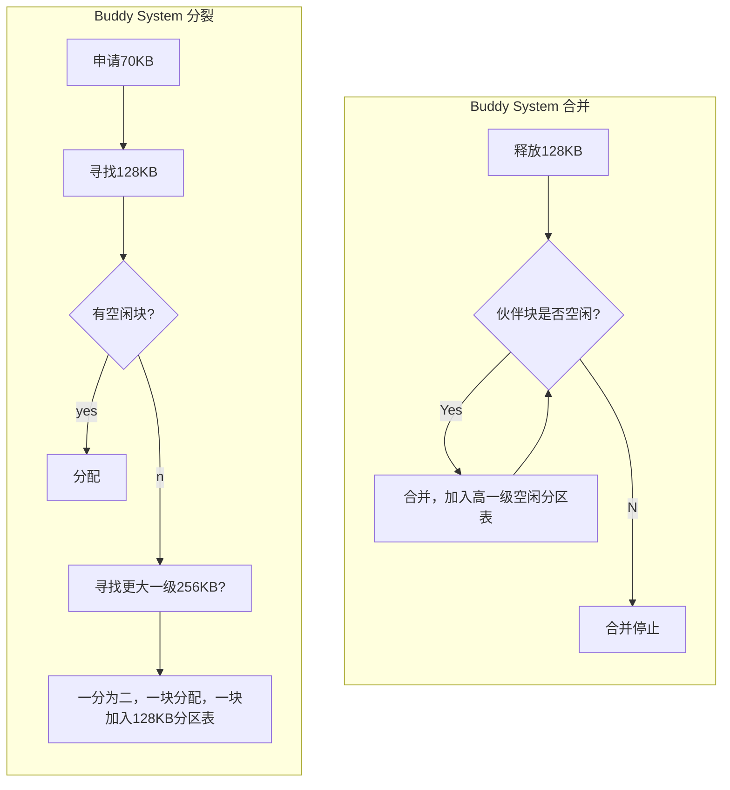
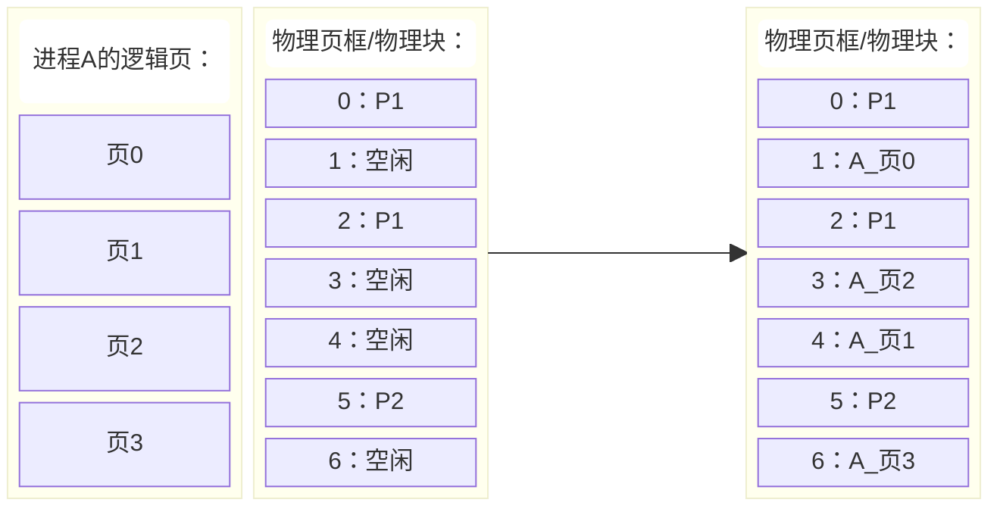

## 第四章  内存管理
*XSUN@GZHU
2026/10/14*

通过前几章的学习，我们知道操作系统能够创建多个进程，使用PCB记录进程状态，并通过调度算法决定哪个进程使用CPU。虽然CPU只有一个，但多个程序可以通过轮流执行表现出同时运行的效果。

那么问题来了：CPU可以轮流使用，**内存 Main Memory**又该怎么办？

要回答这个问题，首先让我们回忆一下计算机存储器的层次结构:


如上图，其采用三级结构，速度和容量存在着不可兼得的关系。我们这一章所关注的是内存(或者称为主存)的管理。

了解了内存在计算机系统所扮演的角色，我们还需要知道：所谓进程需要内存空间究竟是什么意思？也就是问：

**一个磁盘上的可执行程序，究竟是如何变成内存中的指令和数据，并被CPU执行的？**

### 程序装载
简单来说，以如下汇编程序为例：
```nasm
;calculate a + b
LOAD a
ADD b
a:2
b:3
```
其中：
- `LOAD`:从内存读取数据, 后跟数据所在内存地址，机器码是`0x01`
- `ADD`:将内存的数据与`ax`相加, 后根数据所在内存地址，机器码是`0x02`

那么，经过汇编器后得到计算机可以识别的机器码：
```
0x01 0x04 0x02 0x05 0x02 0x03
```
把这些数据加载到内存中，加载的动作早期有人工手动方式向内存中写数据，有了操作系统之后由操作系统完成。假定就从内存地址0处开始加载：
```
地址        数据
0x00        0x01
0x01        0x04
0x02        0x02
0x03        0x05
0x04        0x02
0x05        0x03
```
如此，内存中这最开始的`6B`数据就是该进程在内存中的映像。

如果此时，有另一个程序：
```nasm
;calculate a + 1
LOAD a
INC
a:2
```
其编译后（假定`INC`指令使`ax`自增1，机器码为`0x03`）：
```
0x01 0x03 0x03 0x02
```
也需要装载到内存中，则只能从地址`0x06`开始，且此时标签变量`a`的物理地址就会发生变化，才能保证原程序的正确语义：
```
0x06        0x01
0x07        (0x03) -> (0x09)
0x08        0x02
0x09        0x03
```
`a`的内存地址的变换过程称之为**地址重定位**：一个使程序地址对应到实际内存位置的过程。在本例中，`a`的物理地址的计算：

```math
物理地址 = 基址 + 程序内偏移地址
```
注意，以上模型只是帮大家建立内存管理的直觉，在不同体系结构和装载方式下，地址绑定机制可以不同，现代Linux程序通常采用更复杂的虚拟地址转换机制。

由上例可知，操作系统内存管理的三个基本任务：
- 分配与回收：谁可以使用哪部分内存？
- 地址转换：程序使用的地址如何对应物理位置？
- 内存保护：如何避免进程互相干扰？

### 单一连续
在早期的批处理系统中，内存管理非常简单，首先管理系统本身会占据内存的一部分，然后剩下的部分只能允许一个用户程序占据，这种方式就是单一连续内存分配，如某系统OS占有16K，给用户进程的大小是48KB：
```
0x00000000→---------------+
          |   OS (16K)    |
0x00004000→---------------+
          |               |
          |  USER (48K)   |
          |               |
0x00010000→---------------+
```
对于单一连续分配，如果：
1. 用户程序A只占用10KB，剩余38KB怎么办？
2. 程序A等待键盘输入，CPU暂时没有工作，能不能执行程序B？
3. 若把A从内存中移走，再装入B，有没有代价？

CPU上下文切换与程序内容的换入换出不是同一种成本。前者需要保存/恢复执行上下文，后者可能涉及大量数据传输。

单一连续分配简单，管理开销小，但不适合支持多个用户进程同时驻留内存。

既然可以划出一个用户区，为什么不能将它进一步划成多个分区？

### 固定分区
为了支持多个用户进程，我们可以把之前给USER的48KB分成3个大小为16KB的固定分区：
```
0x00000000→---------------+
          |   OS (16K)    |
0x00004000→---------------+
          |   U1 (16K)    |
0x00008000→---------------+
          |   U2 (16K)    |
0x0000c000→---------------+
          |   U3 (16K)    |
0x00010000→---------------+
```
如此，可让分别进入不同分区，配合进程调度，让多个程序交替运行。此时操作系统需要用一个**分区表**来维护分区状态：
```c
typedef struct entry{
    int start_addr;
    int size;
    bool free;
}entry;

entry partition_table[3];
```
需要知道各个分区的起始地址，大小、是否已被分配等信息。

若此时A(2K)、B(8K)、C(15K)三个进程被装入内存，我们看一下各分区的占用情况：
```
0x00004000                           0x00008000
     +--------------------------------+
    A|■■■■                            |(16K)
     +--------------------------------+
0x00008000                           0x0000c000
     +--------------------------------+
    B|■■■■■■■■■■■■■■■■                |(16K)
     +--------------------------------+
0x0000c000                           0x00010000
     +--------------------------------+
    C|■■■■■■■■■■■■■■■■■■■■■■■■■■■■    |(16K)
     +--------------------------------+
```

计算一下总体内存利用率: $(2+8+15)/48\approx52\%$，而且剩下未使用的 $48-25=23\mathrm{KB}$ 的空间也无法分配给其他进程了。这23KB的空间是由三个分区剩余的空间组成的，这些剩余的空间称为**内部碎片**。此外，若C进程需要22KB的内存，都无法被装入而运行。

一种改善方法是采用空间大小不同的分区，比如：
```
0x00000000→---------------+
          |               |
          |               |
          |   OS (16K)    |
          |               |
0x00004000→---------------+
          |    U1 (4K)    |
0x00005000→---------------+
          |               |
          |    U2 (8K)    |
0x00007000→---------------+
          |               |
          |   U3 (12K)    |
          |               |
0x0000a000→---------------+
          |               |
          |               |
          |               |
          |   U4 (24K)    |
          |               |
          |               |
0x00010000→---------------+
```
这样，不仅可以按匹配大小装入ABC进程，而留出了一个分区：
```
0x00004000   0x00005000
     +--------+
    A|■■■■    |(4K)
     +--------+
0x00005000           0x00007000
     +----------------+
    B|■■■■■■■■■■■■■■■■|(8K)
     +----------------+
0x00007000                   0x0000a000
     +------------------------+
   U3|                        |(12K)
     +------------------------+
0x0000a000                                           0x00010000
     +------------------------------------------------+
    C|■■■■■■■■■■■■■■■■■■■■■■■■■■■■■■■■■■■■■■■■■■■■    |(24K)
     +------------------------------------------------+
```
但是，内部碎片的问题仍热无法得到根本改善！怎么办呢？

其实内部碎片产生的本质原因就是分区是固定的，因此我们动态地改变分区的大小。

### 动态分区
所谓动态分区，就是不事先对内存进行分区，由程序载入和换出动态地决定新来的进程分配到哪一块空闲区。因此，系统需要一个**空闲分区表**来实时地记录空闲区域的状态，比如：

|大小|起始地址|
|--|--|
|10K|0x5000|
|5K|0x7000|
|30K|0x12000|

那么，新到一个进程，如果满足分配需求的空闲分区有很多，应该选择哪个分区分配呢？或者说我们应当设计怎样的算法来找到空闲分区呢？

#### 顺序搜索
寻找空闲分区的第一类算法，是以空闲分区表为基础，进行搜索的方法。

##### 首次适应 first fit
空闲分区表按**地址从小到大**排列，从表头开始，**第一个**满足大小的分配。此方法：
- 低地址被分割地较为零散
- 从头搜索，较慢

##### 循环首次适应 next fit
空闲分区表按**地址从小到大**排列，从**上次搜索位置开始**，第一个满足大小的分配。此方法：
- 分割较为均匀，但缺少大分区
- 从上一次搜索，速度提升
  
##### 最佳适应 best fit
空闲分区表按容量从小到大排列，从表头开始，第一个满足大小的分配。此方法会使内存存在小碎片无法利用。因为总是找最匹配的，导致剩下的空间变少。这种无法利用的内外空间，我们称之为**外部碎片**。

##### 最坏适应 worst fit
空闲分区表按容量从大到小排列，从表头开始，第一个满足大小的分配。这种方法：
- 会让内存缺少较大分区，因为打分去会被不断分割
- 没有很小的外部碎片，因为总是找最大的空闲区进行分配

#### 索引搜索
实际上，经过长时间的运行，内存中实际空闲块的数量很多，那么口空闲分区表就会很长，上述按顺序搜索的方式就会变得十分低效。

如果空闲块数量巨大，操作系统应该用什么数据结构组织它们，才能迅速找到合适的空间？

##### 快速适应 Quick Fit
一种做法是将空间大小相同的空闲块归在一类中，比如：
```
16K: A, B, E
32K: D, F
38K: C
```
这样，就需要不同的分区表来记录空闲块的起始位置，因此，我们还需要一张表来找到这些不同大小的分区表的内存位置，这张表就是**索引表**：

|分区大小|4KB|8KB|16KB|...|
|--|--|--|--|--|
|分区表地址|0x1000|0x2000|0x3000|...|

如，一个进程需要8KB内存空间，就先查索引表找到所有8KB空闲块的空闲分区表，再在分区表中找到一个空闲块，得到其起始地址，分配
给该进程。

Quick Fit是一种通过分类空闲链表改善分配查找速度的方法，是一种典型的**以空间换时间**的工程策略。

利用索引可以减少寻找候选块的开销，但不能消除物理内存碎片。

思考：我们能否动态的合并空闲分区，从而改善碎片问题。

##### 伙伴系统 Buddy System
假设内存被拆成许多不同大小的空闲块，回收一个块后需要检查它的邻居，判断能否合并。有没有办法让拆分和合并遵循简单且统一的规则？

伙伴系统解决这一问题的核心思想是：

- 空闲块的大小限制为2的整数次幂。
- 较大的块可以平均拆分成两个伙伴。
- 两个伙伴都空闲时，可以合并回原来的大块。

例如，一个进程申请70KB的内存，则最小能容纳的2的幂块为128KB：

通过分裂为伙伴块，释放后把伙伴块合并的方式改善内存空间的利用。


例如，现有进程申请20KB的物理内存，某伙伴系统管理的物理内存中，有一个128KB的空闲块，地址从0x100000，表示为：`(起始地址A，块大小S) =(0x100000，128KB)`首先需要将内存划分到32KB：
```
                     128KB
                  (0x100000)
                       ↓
|        64KB          |       64KB       | 
|     (0x100000)       |    (0x110000)    |
           ↓
|* 32KB    |   32KB    |       64KB       |
|(0x100000)|(0x108000) |    (0x110000)    |
```
把`*`号的32KB分给该进程，拆分完成后，伙伴系统记录：

起始物理地址|	大小	|状态
--|--|--
0x100000|	32 KB|	已分配
0x108000|	32 KB|	空闲
0x110000|	64 KB|	空闲

> 注意：拆分空闲块并不需要移动内存中的数据，也不会改变这些物理地址。它只是改变操作系统对同一段物理地址空间的管理方式。

若进程执行完毕，回收0x100000开始的32KB内存，现在开始合并，合并时先找伙伴块的地址：`BuddyA = A ⊕ S = 0x100000 ⊕ 32KB = 0x100000 ⊕ 0x8000 = 0x108000`（`⊕`为按位异或运算，XOR[^2]） 然后检查块`(0x108000, 32KB)`是否空闲，空闲则可以合并。合并后保留较小地址即可，然后再求下一级伙伴块，一直下去，直到不能和并。

伙伴系统不能任意合并所有相邻空闲块。只有符合伙伴关系、大小相同且满足合并条件的块才能直接合并。 所以，伙伴系统改善了拆分、搜索和合并的组织效率[^1]，但仍然没有从根本上解决碎片问题。

[^1]:Linux内核的物理页框管理中使用了这种方法，用于管理不同阶数的连续页框块
[^2]:按位异或运算之所以有用，本质是因为伙伴系统中块大小都是 $2^k$ ,若称地址小者为左伙伴，大者为右伙伴，左右伙伴的地址只在k-bit不同。所以，左右伙伴的地址与块大小 $2^k$ 做异或，正好只改变该位，从而得到右左伙伴的地址。

### 内存紧凑
上述所有方法都会存在碎片问题，一种彻底解决碎片问题的方法是对内存进行紧凑：

```
0x00000000→---------------+             0x00000000→---------------+            
          |               |                       |               |
          |               |                       |               |
          |    A (16K)    |                       |    A (16K)    |
          |               |                       |               |
0x00004000→---------------+             0x00004000→---------------+
          |  free1 (4K)   |                       |               |
0x00005000→---------------+                       |    B (12K)    |
          |               |                       |               |
          |    B (12K)    |  --紧凑-->  0x00007000→---------------+
          |               |                       |               |
0x00008000→---------------+                       |    C (12K)    |            
          |               |                       |               |
          |  free2 (8K)   |             0x0000a000→---------------+
0x0000a000→---------------+                       |               |
          |               |                       |               |
          |    C (12K)    |                       |   free (16K)  |
          |               |                       |               |
0x0000d000→---------------+             0x0000e000→---------------+
          |  free3 (4K)   |
0x0000e000→---------------+
```

这种方式虽然可以把碎片集中起来，但是带来了新的问题：
- 如果进程B被移动，它内部使用的地址怎么办？
- 移动内存中的程序和数据需要付出什么代价？
- 如果程序正在运行或某个设备正在访问相关内存，能否随意移动？

对于地址问题，我们需要动态重定向。其他问题还需要别的机制予以保证，比如搬运数据。因此，这种方法虽然可以解决碎片问题，但是开销极大。

内存利用率和内存的管理与开销是两个不可兼得的工程目标，实际中需要根据场景做出取舍！

### 离散分配
此前的分配算法主要是在优化连续空间的利用，现在让我们重新审视问题本身：

**进程需要一段连续的地址，是否意味着它必须占据连续的物理内存？**

如果我们把一个需要占用内存空间很大的程序拆分成一个个小块，是否就更容易装到较小的内存碎片中了呢？答案是当然的，但是问题是我们要如何拆分呢？

这就不把进程放入连续物理内存空间，而是拆分成离散的部分的内存分配方式就是**离散**分配。这里的离散和连续是针对物理内存空间来说的。

#### 分页
受书本启发，将进程分成大小相同的**页Page**的方式就是分页式内存分配。在分页管理中，相应地我们也把物理内存划分成大小相同的区域，这个区域称为物理块（物理页或者物理页框）。

像书本一样，我们需要一个目录来集中记录各部分内容的页码，这样方便我们快速找到对应的内容。在分页管理中，这个目录就是**页表Page Table**,页表中存储着该进程的每一页所对应的物理块号/物理页框号。于是：
- 一个页可以放入任意一个可用页框。
- 同一个进程的多个页不需要存放在相邻页框。
- 每个进程都有自己的页表，记录每个页对应哪个页框。

那么，接下来的问题就是，每一页的大小是多大合适呢？
- 页面大小过小，利用率高，页表会过长
- 页面大小过大，碎片变多，页表较短

一般根据实际情况，我们取1~8KB。

下面，我们用一个具体例子：
假设进程A需要16 KB空间。页面大小为 $P = 4$ KB，因此进程A共有4个页，它们分别编号为0、1、2、3；物理内存当前有一些空闲页框：

因此，A进程的页表为：

|页号 $p$ |物理块/页框号 $f$ |
|--|--|
|0|1|
|1|4|
|2|3|
|3|6|

程序访问地址`9000[D]`，那么它访问的是第几页？该页内部的哪个位置？其对应的真实物理地址又是多少？

页面大小是4KB( `4KB = 4 x 2^10 = 4096` )，因此逻辑页号 $p$ 和页内偏移 $d$ 分别为（注：以下都是十进制表示。）：

$$
p=\left\lfloor\frac{9000}{4096}\right\rfloor=2
$$
$$
d= 9000\bmod4096=808
$$

页表记录页2对应物理页框3。
则物理地址：
\[
A_p = f \times P + d = 3\times4096+808=13096
\]

由于虚拟页和物理页框大小相同，整个页面放入一个页框时，页面内部数据之间的相对位置没有改变。

在实际的系统中，我们一般使用二进制和十六进制来表示地址，比如在16位操作系统中，进程A若访问其程序内逻辑地址`9000[D]`，我们表示为：

$$
\underbrace{0010}_{页号} \underbrace{0011 0010 1000}_{页内偏移}\mathrm{B} = 2328\mathrm{H} = \mathrm{0x}2328 \\
$$
即，后12位表示页内偏移(`4KB = 2^12`), 前4位表示页号。上述逻辑地址对应的物理地址为： $\mathrm{0x}3328$ ,相比于逻辑地址只是变化了一个十六进制最高位（二进制高4位），页内偏移和页框内偏移是相同的。可见采用如此方式，逻辑地址到物理地址的转化就会变得容易。

我们上面所说“查询页表”，但是没有回答：
- 页表放在哪里？
- CPU如何找到当前进程的页表

在具体的实现，页表一般由操作系统建立并维护，进程的页表也是存储在内存中的特殊位置的，有专门的**页表寄存器(PTR-PageTable Register)** 记录其在内存中的起始地址和页表长度。

##### 多级分页
我们上面使用了16位OS为例，其寻址空间为`2^16=64KB`,页面大小如果是4KB的话，则页表项为16。

对于一个32位的操作系统来说，程序的最大寻址空间位`2^32=4GB`，如果页面大小仍是4KB, 则某进程的页表项最多为`2^20=1M`，页表项过多，会导致页表过大，若占用连续物理内存空间则不太现实。

为此，我们可以采用二级分页方式，就是把页表再进行分页，对其进行离散存储。然后我们用多个一级页表来记录每页对应的物理页框号，用二级页表记录每个一级页表的起始地址。假设页表项占用4个字节，则1M个页表项占用4M字节空间，需要`4M/4K=1024`页来存储此页表，所以一级页表有1024项，对应1024个二级页表。逻辑地址表示可定义如下：
$$
\underbrace{0000000010}_{10位一级索引}\underbrace{0000000001}_{10位二级索引}\underbrace{100000000000}_{12位页内地址}
$$

例如，某进程32位逻辑地址`0x00801800`(一级索引2，二级索引1，页内偏移0x800)所对应的真实物理页框号存储在一级页表第2项所对应的二级页表的第一项处，若该位置存储的值为6，则此逻辑地址对应的物理地址为：`0x00006800`。

除了可以离散存储大页表，一级页表还可以按需建表，从而节省大量物理空间。上述计算中一级页表最多为1024项，但是很多进程也许只需要几项，这样二级页表就会比较少，从而节省了内存空间。

对于更大的地址空间，如现代64位操作系统，其可以寻址的空间达到`2^64=18444744TB`，目前还没有这么大的内存，一般使用45位。对于这种情况我们可以采用三级页表。

> 多级页表本质上是一种**分层索引数据结构**，其目标是以额外的索引层次换取稀疏地址空间下更灵活的页表存储。

#### 分段
假设程序包含代码、数据、栈三个逻辑上不同的部分，而分页只是每4KB划分一次。分页真的关心程序内部的逻辑结构吗？

如果希望操作系统直接按照程序的逻辑结构来组织地址空间，是否应该把它们看成不同的存储单元？这种管理方式就是**分段（Segmentation）**，比如：

那么，分段地址如何表示呢？类似于分页，采用**段号+段内偏移** $(s, d)$ 的方式
，但是注意到和分页不同的是，每段的大小一般是不一样的，所有段表中记录的数据就不再是物理块号，物理内存实际上也不会被分成大小相等的很多页。某进程的段表的一般内容为(10进制表示)：

|段号 $s$|物理基址 $b$|段长度 $L$|
|--|--|--|
|0|1000|1200|
|1|8000|800|
|2|12000|400|

例如，CPU想访问 $(1, 300)$，则按上述段表对应的物理地址为：8300，且300 < 800，是合法的段内访问。

分段方式在程序的逻辑组织上更有优势：
- 代码段可以设置成只读和可执行。
- 数据段可以允许读写。
- 某个逻辑模块可以作为共享单元。
- 每个段可以有自己的长度和保护规则。

注意：这些是分段设计的自然优势，不意味着现代系统必须依赖分段才能实现同类功能。现代分页系统也能够通过页权限和区域映射实现许多类似目标。

但是，分段又带来了新的问题：
- 段长可变。
- 每个段要求连续物理空间。
- 段不断创建、增长、释放，可能形成很多不连续的空闲区域（外部碎片）。

因此，分段虽然不要求整个进程连续存储，但单个段仍有连续性约束。

那么：能否既保持代码段、数据段等逻辑结构，又不要求每个段都连续存放？

#### 段页式
对于上述问题的回答，就是采用段页式存储管理，先分段再分页：
- 按照程序逻辑结构划分成多个段。
- 每个段进一步划分成固定大小的页。
- 各页可以放入不连续的物理页框。

地址的表示为：$(s, p, d)$ 分表为段号，段内页号，和页内偏移。

比如某进程有数据段和代码段：


现在访问地址：$(1,2,100)$ , 假设页面大小为4KB，则其物理地址为：

$$
A_p = 3 \times 4096 + 100 = 12388
$$

在计算之前需要根据段表检查所访问的地址是否在该段的范围内。

段页式管理保留了逻辑分段的组织方式，并通过分页放松了每段物理连续性的要求，但需要管理多层映射结构，增加了实现复杂度。

现代主流通用操作系统更倾向于以分页为核心，并通过虚拟内存区域、权限和映射机制组织进程逻辑空间。

### 内存管理的硬件支撑
通过前面内存管理的讲解，大家已经看到了一个基本事实：**程序使用的地址，与实际存储数据的物理地址可以不同。** 以分页存储(现代操作系统的重要内存管理方式)为例，操作系统通过页表建立逻辑地址与物理地址之间的映射。但是，查询页表进行地址转化的操作谁来完成？

#### MMU - 内存管理单元
如果每次访问内存都要进入操作系统，让操作系统通过软件查询页表，可能产生大量执行开销。因此，现代通用处理器通常提供专门的硬件地址转换：**MMU（Memory Management Unit，内存管理单元）**。MMU是处理器内存访问相关硬件的一部分，负责按照当前地址转换配置，将虚拟地址转换为物理地址，并进行必要的访问权限检查。

因此，操作系统负责建立和修改页表、管理物理页框等；MMU根据当前的映射信息执行地址转换和访问检查。

#### TLB - 快表
在分页管理中，我们说过，页表是存储在物理内存中的，那么我们要访问一个内存地址就得访问两次内存，一次查页表，一次获得真正的数据。假设访问一次内存需要 $t_M=100\mathrm{ns}$ ，那么一次数据访问的总时间是 $t_E=200ns$ （不考虑地址转换的时间），$t_E$ 也称为内存的**有效访问时间EAT-Effective Access Time**。

分页改善了空间分配，却可能使内存访问成本翻倍。这样的代价能接受吗？

如果CPU刚刚访问了虚拟地址0x2001，下一次访问0x2002，还需要再次完整查询页表吗？

答案是不需要，因为0x2001和0x2002都在页2内。那么刚刚从内存页表中获得的页2对应的物理页框号能否保存下来，以便直接使用，从而减少一次内存访问的次数？这个用来保存最近访问的页表项的硬件就成为**快表**或者**TLB-Translation Look aside Buffer**。当然，快表一般使用高速缓冲cache来实现，其访问速度比基于RAM的内存要快很多，访问一次快表所用的时间可以记为 $t_H=20\mathrm{ns}$ 。但是，快表的容量是有限，假设只能放4项：

|TLB项|	页号	|物理页框号|
|--|--|--|
|0|	2|	5|
|1|	7|	3|
|2|	10|	8|
|3|	12|	1|

如果访问地址所处的页号在快表中，那么称为TLB命中（TLB Hit）, 若不在快表中，则称为TLB未命中（TLB Miss）, 此时，在常见硬件管理TLB的体系结构中，处理器会执行页表遍历，并把得到的转换结果缓存起来（**刷新TLB**）。

我们可以计算一下引入TLB之后带来的性能提升，假设TLB的命中率为： $\alpha$，则其内存的有效访问时间的期望为：

$$E(t_E) = \alpha t_H + (1-\alpha)(t_M+t_H) + t_M = 2t_M + t_H -\alpha t_M$$

如果假设 $\alpha=0.9$ ,则有效访问时间为 $2\times100 + 20 - 90 = 130\mathrm{ns}$ ，小于无快表的稳定两次内存访问的200ns。

那么，我们假设 $\alpha=0.9$ 是不是太高了？如果命中率下降，会使得快表的作用减少。事实上，在计算机科学中有个重要的原理，叫做**局部性原理 locality principle**：
- 空间局部性：访问某个地址后，附近地址也可能很快被访问。
- 时间局部性：刚刚访问过的地址或页面，可能在短时间内再次访问。

这个规律在计算机系统中有着非常广泛的应用，快表就是其中之一，我们之后的学习中还会遇到。

### 虚拟内存
我们已经可以让一个进程的不同虚拟页存放在任意物理页框中。但现在还有一个更大胆的问题。

一个程序拥有100万个虚拟页面，是否必须在它开始运行之前，为这100万个页面全部准备好物理页框？

如果程序当前只会访问其中100个页面，其他页面能不能先不放入物理内存？

答案是肯定的，基于之前所说的局部性原理，我们知道程序运行具有时间和空间局部性，这是我们可以不把整个程序，而只把部分局部程序放入内存就可以大概率保证其正常运行的基础。但是，为了完整实现，我们还得解决：
- 如果CPU访问一个尚未驻留物理内存的页面，如何处理？
- 如果物理内存已经满了，操作系统应该把哪个页面移走？
- 分时系统中有多个进程，每个进程放入多少页？

解决了上述问题，便诞生了我们所说的**虚拟内存 virtual memory**技术。在此框架下，有以下几种具体方案：
- 固定分配局部置换：每个进程分配一样数量的物理块，换出时换已分配给该进程的块。
- 可变分配局部置换：每个进程分配数量按某种规则决定，换出时换已分配给该进程的块。
- 可变分配全局置换：每个进程分配数量按某种规则决定，换出时可选系统中的所有块。

其中可变分配的方式有：
- 平均分配：$n$ 个进程 $m$ 个块，则每个 $m/n$ 块。
- 按比例分配： $n$ 个进程，$i$ 程序需要 $s_i$ 页，则分配 $b_i = ms_i/\sum{s_i}$
- 优先级：越重要的，分配越多

下面我们基于分页内存管理，讲解虚拟内存技术的具体实现。

#### 请求分页
在分页管理的页表中需要额外增加一个字段/属性，来标识该进程的某页是否驻留在物理内存中：

|页号|	物理页框号	|驻留状态 P|
|--|--|--|
|0|	2|	1|
|1|	7|	0|
|2|	10|	0|
|3|	12|	1|

若所访问的页面的状态 `P=1`，则和分页管理中一样，获得物理页框号，正常进行地址转化即可；若`P=0`则会引发**缺页异常 Page Fault**, 触发缺页中断(请回忆第二章中所讲的中断的概念)，执行缺页中断处理函数：

系统会检查内存是否已满，若未满，则从外存中将该页读入内存，然后修改页表，获得物理页框号，进行地址转化；若内存已满，则需要从物理内存中选择一页换出。上述流程图即使缺页中断处理函数的执行流程，若我们设满内存的概率为 $\gamma$, 页面被修改的概率为 $\beta$，则缺页中断处理函数的处理时间的期望为：

$$\epsilon = t_r + \gamma(t_x+\beta t_s)$$

其中:
- $t_r$ :从外存加载一页到内存所需的时间
- $t_s$ :写回一页到外存所需的时间
- $t_x$ :从内存换出一页到内存所需的时间

在有快表TLB的系统中，机制是类似的，只不过会先查询TLB，而不是先访问内存中的页表。根据之前所学，我们可以计算有TLB的请求分页系统的有效内存访问时间：

$$

\begin{aligned}
    T_E = & 2t_M + t_H -\alpha t_M + p\epsilon\\
     = & 2t_M + t_H -\alpha t_M + pt_r + \gamma pt_x + \gamma p \beta t_x
\end{aligned}
$$
其中 $p$ 为缺页率。可见，请求分页内存管理的有效访问时间受多种因素的影响。

#### 页面置换
在缺页异常的中断处理函数中，若当前内存已满。需要换出一个页面，那么究竟应该换出哪个页面呢？我们需要一定的策略来决定被换出的页面，这就是**页面置换算法Page Replacement Algorithm**。可以采用缺页率 $p$ 来评价算法的优劣。

##### 最优置换算法 OPT
如果知道进程未来会访问的所有页面，最优置换算法 Optimal replacement algorithm的思想是换出那个未来最晚再次使用，或者以后再也不会使用的页面。它在给定引用串及固定页框数等标准假设下，能够使缺页次数最少。例如：

假设某进程已经装入内存的页号为：`[1,0,7]`, 若 $t$ 时刻之后，程序需要访问的页面序列(页号)为：
```
2, 0, 3, 0, 4, 2, 3, 0, 3, 2, 1, 2, 0, 1, 7, 0, 1
   ↑                          ↑           ↑
  t+1                        t+10        t+14
```
$t$ 时刻访问页面2，需要换出7，因为7在未来序列中最晚被访问(`t+14`)，依次类推，得到各个时刻的页面置换情况：
```
时间      请求      缺页      换出      驻留
t          2        x         7      [1,0,2]
t+1        0        -         -      [1,0,2]
t+2        3        x         1      [3,0,2]
t+3        0        -         -      [3,0,2]
t+4        4        x         0      [3,4,2]
t+5        2        -         -      [3,4,2]
t+6        3        -         -      [3,4,2]
t+7        0        x         4      [3,0,2]
t+8        3        -         -      [3,0,2]
t+9        2        -         -      [3,0,2]
t+10       1        x         3      [1,0,2]
t+11       2        -         -      [1,0,2]
t+12       0        -         -      [1,0,2]
t+13       1        -         -      [1,0,2]
t+14       7        x         2      [1,0,7]
t+15       0        -         -      [1,0,7]
t+16       1        -         -      [1,0,7]
```
共发生6次缺页，缺页率为： $p = \frac{6}{17}\times100\% \approx 35.29\%$ 。但是，在现实中很难知道程序未来的页面访问序列。因此，此算法只做性能标准来评价其他算法。

##### 最先进入内存的页面最先离开 FIFO 
既然不能预测未来，那是否可以使用一个容易实现的规则？

最简单的是FIFO（First In, First Out）。按照页面进入驻留集的先后次序维护队列，需要淘汰时移走最早进入的页面。

但是，最早进入内存的页面，不一定是近期最不需要的页面。

例如一个循环中频繁访问的代码页，可能很早就进入内存，却仍然在被反复访问。
FIFO可能把这样的页面淘汰，导致下一次访问时又发生缺页。上例采用FIFO算法的话，缺页率将达到70%以上。

FIFO的工程实现比较容易：使用一个链表记录页面的装入顺序，替换指针指向最早被调入内存的页面，即仍在内存中的链表头。

##### 最近最久未使用的页面 LRU
FIFO的缺点在于仅考虑进入时间，而不考虑页面是否频繁被访问。

我们能否根据程序过去的访问行为，推测哪些页面未来更有可能被使用？

最常见的策略是LRU（Least Recently Used）：淘汰距离当前时刻最久没有被访问的页面。针对上例，页面置换结果为（已存在驻留页面的历史访问顺序为`7,0,1`）：
```
时间      请求      缺页      换出      驻留
t          2        x         7      [1,0,2]
t+1        0        -         -      [1,0,2]
t+2        3        x         1      [3,0,2]
t+3        0        -         -      [3,0,2]
t+4        4        x         2      [3,0,4]
t+5        2        x         3      [2,0,4]
t+6        3        x         0      [2,3,4]
t+7        0        x         4      [2,3,0]
t+8        3        -         -      [2,3,0]
t+9        2        -         -      [2,3,0]
t+10       1        x         3      [2,3,1]
t+11       2        -         -      [2,3,1]
t+12       0        x         3      [2,0,1]
t+13       1        -         -      [2,0,1]
t+14       7        x         2      [7,0,1]
t+15       0        -         -      [1,0,7]
t+16       1        -         -      [1,0,7]
```
此置换算法发生了9次缺页，缺页率 $p = \frac{9}{17}\times100\% \approx 52.94\%$ 。注意，LRU算法下被访问多次并不直接等于优先保留，关键是**最近一次访问的时间**。

LRU的实现可以采用栈结构，栈大小和物理页框数一致，每次访问一个页面就先从栈中POP出该页面，再PUSH进栈，这样每次换出栈底页面即是最近最久未使用的页面。

##### 最少使用置换算法 LFU
LRU根据的是最近使用的页面，LFU-least frequently used 则是统计页面被使用的次数，换出使用次数最少的页面。其核心思想和LRU类似且缺页率和LRU相当，但是我们以多大的时间窗口来统计访问的频次呢？实际上，在具体实现时，我们可以采用如下的寄存器硬件设计来实现对访问页面的频次的统计：

为每一页设置一个移位寄存器，每次页面被访问就将最高位置1，然后每隔一定的时间，将该寄存器右移一位。换出页面时，选择数值最小的寄存器所对应的页面换出即可。

这种被访问就置位的思想也可以借鉴到LRU的硬件实现上，以避免使用过大的堆栈结构来实现。

##### Clock 置换算法
对LRU进行工程实现上的近似算法就是clock算法：为每个内存页分配一个访问位：
- 页面被访问时，R可被硬件或软件置为1。
- 时钟指针按FIFO扫描页面。
- 遇到R=1的页面，把R清零，给予第二次机会。
- 遇到R=0的页面，将其选为置换候选。

Clock利用较少的状态信息，近似判断哪些页面最近被使用过。

为了综合考虑写回成本，还有改进Clock算法：同时考虑访问位R和修改位M，倾向选择近期未访问、且不需要昂贵写回的页面。

#### 抖动与工作集中
操作系统增加同时运行的进程数量，本来是为了提高CPU利用率。但当内存不足时，继续增加进程数量，CPU利用率反而可能下降。

当系统中进程过多时，进程所需要的总内存大小超过了系统的真实物理内存时，再好的页面置换算法(可以用OPT来衡量)也无法减少缺页的发生。此时，若缺页平均处理时间为 $S$, 缺页之间的平均时间是 $L$, 倘若 $L/S < 1$ 则意味着缺页频繁发生，此时大量进程因为所访问的页面不在内存中，都处在磁盘IO阻塞状态，CPU则忙于换入和换出页面，这种现象我们称之为**抖动Trashing**：即CPU刚换出一个页面，让一个进程得以运行，然后又要把刚才换出的页面换入，因为另一个进程需要访问。这就是由于物理内存空间已达容纳上限后带来的频繁缺页，致使系统效率极具下降！

因此，“不是所有时候都应该让尽可能多的进程同时驻留。”但操作系统怎么知道一个进程当前到底需要多少页框？
- 如果分配太少，会导致频繁缺页。
- 如果分配太多，又可能浪费物理内存（且缺页率和物理分配大小存在边际效应），降低可以并发运行的进程数量。

根据局部性原理，一个可行的方案是只将最近一段时间 $\Delta$ 内访问过的页面装入内存中，这些页面就构成**工作集Working Set**: $W(t,\Delta)$ ，换句话说，我们只把进程的工作集装入到物理内存中，作为该进程的**驻留集Resident Set**。注意，实际中工作集和驻留集不一定能够保持相同。

例如，某进程从 $t=0$ 时刻后的页面访问如下：

```
时间 t    访问页面       工作集(Δ=2)       工作集(Δ=3)
0            1             [1]               [1]
1            2            [1,2]             [1,2]
2            4            [2,4]            [1,2,4]
2            2            [2,4]            [1,2,4]
2            4            [2,4]            [1,2,4]
2            2            [2,4]            [1,2,4]
2            3            [3,4]            [3,2,4]
2            5            [3,5]            [3,5,4]
2            3            [3,5]            [3,5,4]
2            4            [3,4]            [3,5,4]
2            2            [2,4]            [3,2,4]
```
可以观察到，时间窗口 $\Delta$:
- 窗口太短，可能漏掉虽然不频繁但仍在当前阶段需要的页面。
- 窗口太长，又可能把已经不再活跃的页面算进去，使工作集估计偏大。

且工作及的大小是关于时间窗口的非降函数：

$$W(t,\Delta) \subseteq W(t,\Delta + 
\delta), \delta > 0$$

若定义工作集的大小： $WSS(t,\Delta) = |W(t,\Delta)|$, 则也有：


$$WSS(t,\Delta) \le WSS(t,\Delta + 
\delta), \delta > 0$$

在实际应用中，我们常常根据进程的驻留集和工作集的相对大小来判断系统的内存状态。

---

整个章节我们学习了很多内存管理的技术，把**程序需要的地址空间与实际物理存储位置分离**，是内存管理技术发生根本变化的关键。

总结：内存管理的价值，不是把物理内存凭空变大，而是通过**地址抽象、按需驻留和动态资源管理**，让进程不必关心**自身数据在物理内存中的具体位置**，也不**必要求全部数据始终驻留RAM**。这与课程最初“操作系统如何让计算机更美好”的目标完全吻合。
