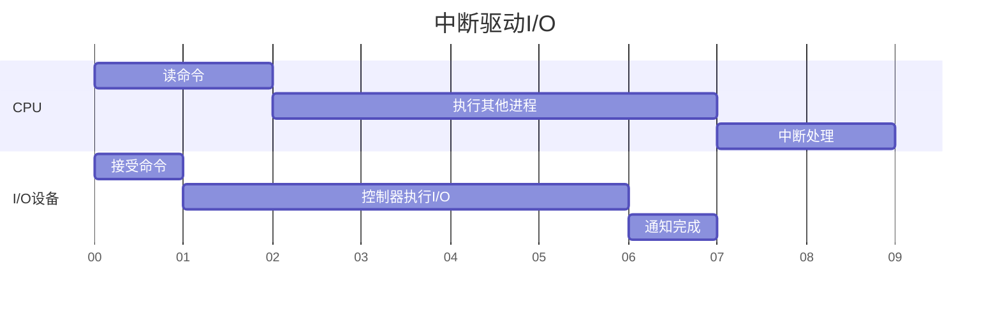

## 第五章  IO管理和文件系统
*XSUN@GZHU
2026/10/23*

当我们在电脑上创建一个 `hello.txt` 文件，输入一段文字，点击保存，再关闭并重新打开时，然后再把它删除，操作系统究竟做了什么保证这些过程的实现？

这就是本章所要探讨的问题：
- 数据最终要写入磁盘，而磁盘与 CPU、内存有本质区别。
- CPU 不能像访问内存那样直接、统一地操作所有外部设备。
- 操作系统需要组织 I/O 请求，控制设备，并协调进程的执行。
- 文件不能仅仅是磁盘上的一段数据，还需要名称、大小、位置等管理信息。
- 一个文件可能占据多个不连续的磁盘块，操作系统需要记录它们的位置。
- 文件删除后，操作系统需要回收磁盘空间，并供后续文件使用。

这就形成了从硬件到软件抽象的自然逻辑：
```
用户需求 -> 逻辑抽象 -> 外存空间管理 -> I/O系统 -> 硬件设备
```
本章，我们将从硬件设备(因为它是一切限制的起点)开始，逐步构建上述的功能层次，让用户可以更方便地使用计算机。操作系统让计算机更美好！

### I/O 管理
所谓地I/O(Input/Output)是针对CPU和内存来说的，即是计算机系统的外部设备，常见的I/O设备如鼠标，键盘，打印机，磁盘(硬盘)，扬声器，麦克风，显示器等等。

IO设备构建了人和计算机进行交流的重要桥梁：如果计算机只是计算，而不以人类更容易理解的方式呈现结果，或者不以人类的方式接收指令，就不能称之为好用(easy to use)！因此，IO管理是操作系统中决定用户体验非常重要的部分。
#### I/O设备
我们已经学过内存管理，那么：
> 一个进程执行 a = b + c 时，CPU 从内存读取数据、进行运算，再将结果写回内存。如果一个程序需要读取键盘输入，或者把结果保存到硬盘中，CPU 能否采用完全一样的工作方式？

显然不行，因为：
1. **不同设备的操作语义不同**：
   键盘产生输入事件，显示器输出图像，磁盘保存数据块，网卡收发网络数据。显然，不可能要求所有设备具有完全相同的功能和控制命令。
2. **设备的运行速度和 CPU 相差很大**：
   CPU 在等待用户按键的过程中，如果只能一直等待，那么计算机就无法有效运行其他程序。
3. **设备往往是多个程序共同需要的资源**：
   假设多个程序同时需要向磁盘写入数据，那么谁先执行？如何避免相互干扰？怎样处理操作失败？

因此，操作系统不仅要管理 CPU 和内存，还必须负责管理外部设备，对不同设备提供适当的访问方式，并协调设备与进程之间的工作。

I/O设备纷繁多样，如果每出现一个新的IO设备，CPU就得升级去适配新设备的特性，这显然是不合适的。因此，在CPU与IO物理设备之间需要存在一个中间系统，我们称之为设备控制器（一般由设备厂商集成到设备中）：

CPU 通常通过控制器提供的寄存器、命令队列等接口与设备交互，而不是直接操作设备内部的所有物理结构。设备控制器主要负责接收命令、报告状态和协调设备的数据传输等工作。

#### I/O设备与CPU的协调
假设磁盘控制器收到一个读请求，需要一定时间才能返回结果。操作系统如何协调CPU和IO设备的工作呢？

一种简单的方式是：
```
CPU 发出读取命令

while (设备尚未完成):
    继续查询设备状态

读取结果
```
这种方式称为**轮询(polling)**。但是CPU 可能在等待期间反复执行没有实际数据处理价值的查询。轮询并非一定不好。 对于响应极快或需要极低延迟的场景，轮询仍可能是合理选择。它的问题在于：当等待时间较长时，持续轮询可能浪费 CPU 资源。

于是，我们需要中断系统(在讲到硬件原语时，我们有提到过)：等设备完成时通过中断请求的方式主动通知CPU：

此外，如果每传输一个字节都需要 CPU 亲自参与，传输一大块数据时仍然会占用大量 CPU 时间。能否让硬件直接在设备和内存之间搬运数据？

这就是DMA-Direct Memory Access，直接内存访问技术，工作流程：CPU 仅需初始化并下达指令（提供传输源地址、目的地址和数据长度），随后由专门的 DMA 控制器（DMAC） 独立执行数据搬运。传输完成后，DMA 向 CPU 发送中断信号。

#### I/O系统的层次结构
如果每个应用程序都必须知道不同硬盘型号的控制命令，那么我们换一块硬盘，是否需要修改所有应用程序？

显然，这种设计难以维护，操作系统需要让计算机更好用，可提供将设备请求转换为针对具体硬件的操作。例如，文件系统可能希望读取某个逻辑块，但底层不同设备与控制器完成读取操作的具体方式可能不同。

这就是**设备驱动程序**，它是隔离这种硬件差异的重要机制。

我们在Linux的中:
```c
read(fd, buffer, n);
write(fd, buffer, n);
```
同样的 read()、write() 接口可以访问多种不同类型的对象，但各类对象支持的操作及具体语义可能不同。这使得应用程序在很多情况下可以复用相同的访问代码。

这就实现了**设备无关性**，它意味着尽量向上层提供稳定、通用的操作接口，将与具体设备相关的实现细节封装在下层的设备驱动程序，而不是强行要求所有设备完全相同。

此外，我们还需考虑：
> 文本编辑器每写入一个字符，都要立即执行一次物理磁盘写入吗？

因此，我们还需要缓存/缓冲系统：
- 减少频繁的小规模 I/O 操作。
- 协调生产数据和消费数据的速度差异。
- 允许应用程序与设备的处理在时间上适当解耦。

综上，IO系统的层次结构可以总结如下：

|层次|	主要职责|	面向谁|
|--|--|--|
|用户级 I/O 软件|	库函数、应用层缓冲等|	应用程序|
|设备无关的软件|	通用接口、命名、缓冲、错误处理等|	各类设备|
|设备驱动程序	|将请求转化为设备操作	|特定设备|
|中断处理机制|	响应硬件事件，通知或推进 I/O 完成处理|	内核与驱动|
|设备控制器和硬件	|执行实际设备操作|	物理设备|

操作系统通过设备控制、执行协调和分层抽象，将复杂的外部设备转化为应用程序能够方便使用的服务。

### 文件的逻辑组织
到现在为止，假设我们已经可以通过 I/O 系统读取或写入磁盘中的任何一个数据块，那么，操作系统是否已经具备了我们平时所理解的“文件管理”能力？

显然是没有的。比如，假设磁盘只有 1000 个块，编号为：
```
0, 1, 2, ..., 999
```
用户想保存一篇论文。操作系统告诉用户：“你的论文被保存在第 100、101、102 号磁盘块中。” 下次用户想要打开论文，就得告诉操作系统我要100、101、102号磁盘块中的内容。显然，这种方式非常不方便。

所以，为了让用户更好地操作文件，操作系统需要解决：
1. 用户怎么记住这些块？
2. 如何找到文件对应的盘块？
3. 如何管理多个文件和同名文件？
4. 用户对于文件的各种操作如何实现？
   
对于问题1，我们可以给用户提供一个人类容易理解的标识：文件名，如`paper.txt`, 用户只用记住这个名字即可。

对于问题2，操作系统需要维护文件名与相关数据之间的关联。

对于问题3，操作系统需要**目录**这样的多层次组织结构:`user1/paper.txt`, `user2/paper.txt`。

对于问题4，常见的文件操作有：`create、open、read、write、close、delete` 等。

因此，文件系统的本质：提供的一种命名的数据组织与管理**抽象**，使程序和用户能够以文件为单位保存、查找和访问数据，而不必直接操作底层物理存储位置。

|没有文件抽象	|有文件抽象|
|--|--|
|需要知道磁盘块的位置|	使用文件名或路径|
|需要自己维护数据块关系|	文件系统负责维护|
|需要自己跟踪数据大小	|文件系统维护文件大小|
|直接操作存储设备	|使用统一的文件访问接口|

那么，具体如何实现呢？

#### FCB - File Control Block
FCB这个名字很熟悉，OS管理进程用PCB，管理文件用FCB。类似PCB中维护了进程的pid, 状态，地址空间等信息，FCB中保存的是文件的元数据，如：
```c
FCB:
-name
-extend
-time
-date
-blocks // number of blocks
-first block // first block No.
-type
-owner
...
```
这些数据是OS对文件进行管理的必需信息，如文件名与物理磁盘块的管理，文件所有者，文件的创建时间等等。

注意：FCB也是保存在磁盘上的，因此引入FCB后，访问磁盘的次数相比于直接访问文件数据会增加。

#### 目录结构
一个文件对应一个FCB，那么目录就是FCB的集合。文件系统中目录的组织形式可以是：
- 单级目录：不需要额外数据结构，每个文件的FCB排列在一起即可
- 两级目录：需要一个目录数据结构，保存目录的编号及其下文件FCB的首地址，每个目录下文件的FCB可按链表排列
- 树形目录：目前操作系统最实用和通用的目录组织结构，如：
  ```mermaid
  treeView-beta
    A/
        D/
            index.js
        E/
            text.py
        F/
            L/
            M/
                circle.mp4
            N/
                square.mp3
    B/
        X/
            draw.png
        Y/
            happy.c
            Q/
            N/
    C/
        x.txt
  ```
  则：
  - `draw.png`的**绝对路径**为`/B/Y`
  - 当前目录为`B/`，则`draw.png`的**相对路径**为`/Y`
  - `A/B`是目录
  - `X`是`A/B`的子目录
  - `L`,`Q`,`N`都是空目录
  - `A/`是`D/`,`E/`,`F/`的父目录

树形目录结构(Tree-structured Directory) 可以让用户拥有更加灵活和清晰的文件组织形式，也能加快逻辑空间查找文件的速度，但是磁盘访问次数会增加（目录数据结构也存储在磁盘上）。

#### Unix - inode
在典型 Unix 文件系统中，对FCB的具体实现采用了叫做索引节点index node(inode)的数据结构：首先将文件名关联到`inode`编号；而在`inode`中保存文件的元数据：
```c
inode:
-User [owner]
-Group
-Type [regular/directory/special]
-Links [number of pointers to this inode]
-Mode
-Block
-Size [size in byte]
-ctime
-atime
-mtime
-iaddr[13] // physical store
```
这样检索时，只需按照文件名匹配找到inode编号，即可找到文件的元数据。

我们可以在Linux系统中观察目录和文件的inode编号，比如当前的工作目录( working directory)为`/home/sxl/fs`，且该目录下只有一个文件`file.txt`, 那么运行如下命令：
```bash
ls -i
```
的输出为：
```
12654 file.txt
```
其中第一列的`12654`就是`file.txt`这个文件名对应的inode编号。然后可以查看具体的inode中的内容：
```
stat file.txt
```
输出：
```
  File: file.txt
  Size: 6               Blocks: 8          IO Block: 4096   regular file
Device: 830h/2096d      Inode: 12654       Links: 1
Access: (0644/-rw-r--r--)  Uid: ( 1000/     sxl)   Gid: ( 1000/     sxl)
Access: 2026-10-23 15:02:45.495635277 +0800
Modify: 2026-10-23 15:02:42.387303282 +0800
Change: 2026-10-23 15:02:42.387303282 +0800
 Birth: 2026-10-23 15:02:33.061019297 +0800
```
这些都是由inode信息解析出的文件元数据。

如果我们此时显示该目录下的所有文件(包括隐藏目录)的inode：
```
ls -ai
```
你会发现输出为：
```
10985 .    654 ..  12654 file.txt
```
其中，`.`表示当前目录的，`..`表示父目录(上级目录，即：`/home/sxl`)

I/O 管理让程序不必直接控制复杂的硬件；文件系统进一步让程序不必直接管理磁盘块。**操作系统正是通过逐层抽象，不断降低应用程序使用硬件资源的复杂度。**

### 文件的物理组织
现在知道了：操作系统可以把一组持久化数据组织成文件，并通过文件名找到文件的元数据。
但是，一个文件可能包含大量数据，这些数据具体存放在哪些磁盘块中？操作系统如何找到它们呢？也就是问，文件的在磁盘上的物理组织究竟是怎样的？

回忆我们学习过的内存管理，磁盘也是存储空间，所以可以借鉴内存管理的方案来进行磁盘的管理。

#### 连续组织
假设磁盘尚未存放任何文件。现在需要保存一个占用 5 个磁盘块的文件 A，你会怎样安排？

可以找 5 个连续的空闲块，这就是连续分配。由于文件数据是连续存放在物理磁盘块上的，只需记录初始物理块号和分配的块数即可，回忆FCB中的字段：
```c
FCB:
-name
...
-blocks // number of blocks
-first block // first block No.
...
```
现在文件 A 从 5 个块增长到 8 个块。如果紧邻文件 A 的空间已经被文件 B 占用，该怎么办？即使预留更多空间，也不能确定文件未来究竟增长多少。

所以，这种文件组织方式：
- 访问容易，速度快
- 产生碎片（难以找到长度条件的连续物理块）
- 需事先知道文件长度
- 动态操作难：插入，删除，动态增长


#### 链接组织
就像内存管理一样，为什么要求同一文件的数据块必须连续？如果允许不连续，能否解决连续组织的诸多问题？

##### 隐式链接
现在假设磁盘中只有物理块 3、9、2、14、6 是空闲的。

能不能用这五个块保存文件 A？当然可以，但我们必须记录它们之间的逻辑顺序。

最简单的办法是：每个数据块记录下一个数据块的物理块号。

链接分配解决了文件连续存储和扩展的问题，但牺牲了高效随机访问的能力。

所以，这种方式：
- 离散存储，消除碎片
- 插入，修改都较容易实现
- 随机访问效率低，必须从第一个开始
- 一个指针出错，全部都错

##### 显式链接 - FAT
既然文件块中的指针只是用于记录链接关系，为什么不把所有链接关系集中保存到一张表中？

这张表就是文件分配表-FAT（File Allocation Table）。例如：

|物理块号|	下一块|
|--|--|
|2|	14|
|3|	9|
|6|EOF|
|9|	2|
|14|6|

文件起始块为3：则读取顺序：`3 -> 9 -> 2 -> 14 -> EOF`, 其中`EOF=end of file`。

在第一章操作系统的历史中，我们说到FAT文件系统是比尔盖茨起家的产品，他从FAT12-FAT16-FAT32转变。所谓FAT12是指文件分配表中的每一项有12位，FAT12中会把磁盘分区，每个分区一章FAT表，若一个磁盘块的容量为512B，那么我们可以计算一个分区的容量大小为：`512 x 2^12 = 2MB`。为了提高容量，可以：
- 增加文件表项的位数，`12 -> 16 -> 32`
- 增加一个盘块的容量，把相邻 $N$ 个盘块合成一个簇，按簇为最小分配单位。 $N$ 越大，容量越大，但会有“簇内碎片”

在FAT32文件系统中，按硬盘大小确定簇的大小：
- < 8G:8扇区为一簇，簇大小4K
- 8~16G:16扇区为一簇，簇大小为8K
- 16~32G:32扇区为一簇，簇大小为16K
- \> 32G: 64扇区为一簇，簇大小32K

将 FAT 缓存在内存中可以显著减少沿链寻找时的磁盘 I/O，但并没有消除链式查找本身。


##### 索引分配
链接分配的关键限制是必须一个接一个地寻找。如果我们直接记录文件每个逻辑块对应的物理块号，是否可以快速定位任意一个块？

假设文件 A 的逻辑块与物理块对应关系如下：
```
文件逻辑块号	0	1	2	3	4
磁盘物理块号	3	9	2	14	6
```
可以直接把这组映射关系放到一个索引块中。与 FAT 对比：
- FAT 保存的是某个物理块之后应该访问哪个物理块。
- 索引表直接按照文件逻辑块顺序保存物理块地址。

如果一个索引块本身只能容纳有限个地址，那么一个特别大的文件怎么办？比如：
- 一个磁盘块为 4 KiB。
- 每个物理块地址占 4 字节。
- 一个索引块只保存这些块地址，不考虑其他开销。

一个索引块可以存放：

$$
N = \frac{4096}{4} = 1024
$$
个地址。如果一个索引项对应一个 4 KiB 数据块，那么单个索引块最多直接映射： $1024 \times 4\mathrm{KiB} = 4 \mathrm{MiB}$ 的数据。但是一个文件如果100MiB, 怎么办？

这时可以采用多级索引（回忆多级页表，其思想内核是一致的）：把索引块分开保存在不同的磁盘块中，然后用一级索引保存下一级索引块的地址。假设仍然每个索引块可以容纳 1024 个地址，那么二级索引最多可映射：$1024^2\times4\text{ KiB}=4\text{ GiB}$ 。

三级索引则可以进一步扩大可寻址范围 [^1]。

[^1]: 这里的容量计算只是理论模型，实际文件系统还会受块号宽度、文件大小字段、元数据布局和文件系统限制的约束。

实际应用时，针对最常见的情况优化性能，同时通过更复杂的机制支持少见但规模更大的情况：小文件使用直接指针，减少额外索引访问；大文件采用多级索引，保证扩展能力。这就是**混合（增量）索引**模式。在之前所讲的 `inode`中就有所体现：
```c
inode:
-User [owner]
-Group
-Type 
-Links 
-Mode
-Size [size in byte]
-iaddr0
// 直接地址
-iaddr1
…
-iaddr9
// 一级索引块地址
iaddr10
// 二级索引块地址
-iaddr11
// 三级索引块地址
-iaddr12
```
若仍然假设盘块大小为1K，索引项为4B，则：
- 10个直接索引可以映射40KB数据
- 一级间接索引可以映射4MB
- 二级间接索引可以映射4GB

##### Linux - Extent
假设一个文件包含 1000 个逻辑块，而且恰好被连续分配在物理块 5000～5999。

传统按块索引需要记录：

```
5000, 5001, 5002, ..., 5999
```

既然连续 1000 个块的地址都有规律，为什么还要保存 1000 个独立的地址？

完全可以只保存一段区间。这就是 **extent（盘区）**的核心思想。

注意 extent 并不强制整个文件连续，只是尽可能使用连续区间描述已经分配的数据。因此，extent 可以显著降低连续大量数据块的元数据开销。

##### Windows - NTFS
在 Unix 风格文件系统中，我们可以通过 inode 获得文件大小、属性以及数据块定位信息。在 NTFS 中，一个文件的元数据存放在**主文件表MFT-Master File Table**中，表中的第一项是MFT本身。NTFS 的一种重要设计是，把描述文件的记录集中组织在 MFT 中, 每个文件拥有至少一条相应的文件记录，用来描述文件的属性及其数据位置。

在 NTFS 中，文件内容本身也是文件的一种属性，即 `$DATA`。如果 MFT 文件记录中有足够空间，就可以将文件的 `$DATA` 属性值直接保存在记录内部。这被称为 **Resident Attribute（驻留属性）**。当`$DATA` 属性无法全部放入 MFT 记录时，NTFS 可以在卷中分配数据簇存放内容。MFT 文件记录并不需要保存所有数据本身，而是保存定位这些数据所需的信息。

此外，作为NTFS-New Technology File System，该文件系统还引入了：
- 使用 `$LogFile` 记录文件系统事务相关的日志信息，帮助系统在异常中断后恢复元数据一致性。
- 数据一致性
- 文件加密与压缩
- 大文件支持

这些特性使得NTFS成为现代windows系统的主流文件系统。

对本部分内存作如下总结：

|方法|	地址记录方式|	主要优点|	主要局限|
|--|--|--|--|
连续分配|	起始块 + 长度|	简单、定位快速|	文件增长困难
隐式链接|	每块记录下一块|	扩展方便|	随机访问低效
FAT|	独立表记录后继关系|	链接信息集中管理|	沿链查找、表空间开销
单级/多级索引|	按逻辑块号组织物理地址|	便于随机访问|	需要索引存储空间
Extent 索引|	逻辑区间到物理区间的映射|	连续数据块的元数据紧凑	|严重碎片化时条目增多

常见现实文件系统与课程的关联：

|文件系统|	重点机制| 联系|
|--|--|--|
|FAT|	文件分配表|	显式链接分配|
|经典 Unix 文件系统|	inode 与直接、间接块指针|	混合索引
|ext4|	Extent tree	|连续区间与树形索引结合|
|NTFS|	MFT |与非驻留数据的运行区映射|	文件元数据组织及连续区间描述

### 空闲盘块管理
前面讲的是文件块如何映射，现在我们关注另外一个问题：当文件需要占用新的磁盘块时，操作系统怎么知道哪些块是空闲的？如何分配和回收？

现在假设创建了一个新文件 B，需要分配 3 个数据块。

问题来了：
> 文件系统到底从哪里找到这三个可以使用的磁盘块？

文件的 inode 或索引表告诉操作系统已分配块在哪里，但不能仅凭某个文件的索引表知道整个文件系统中还有哪些空闲块。

因此，必须有一种能够反映整个文件系统空间使用情况的管理机制。

#### 空闲表法
假设磁盘有 20 个块，其中空闲块为：
```
2, 3, 7, 8, 9, 12, 15, 16, 18
```
最简单的想法是把这些编号保存起来。对于连续的盘块，参考extent的思想，可以记录连续的空闲盘块数量：

|第一空闲盘块号|盘快数|
|--|--|
|2|4|
|8|2|
|16|9|
|...|...|
|486|22|

但随着磁盘容量增大，问题也出现了：
- 保存大量空闲块号会占用空间。
- 分配后需要更新记录。
- 回收时也必须保证记录正确。
- 如果要连续分配多个块，可能还需要查找。

因此必须设计合适的数据结构。

#### 空闲盘块链
第一种思想：将所有空闲块链接起来。分配一个块，可以从链表取出一个空闲块。回收一个块，则将它重新加入空闲链（可加入链尾）。

这种方法与前面讲过的文件链接分配很相似，但两条链表管理的对象不同：
- 文件链接分配中的链表：属于同一个文件的数据块。
- 空闲盘块链：尚未分配的数据块。

如果系统希望分配 100 个连续的数据块，从逐块链接的空闲链表中寻找是否方便？

#### 空闲盘区链
前面已经讲过 extent，现在应该意识到：如果文件系统经常需要连续的空闲块，最好直接管理空闲的连续区间。如：

|空闲盘区|	起始块号|	连续块数|
|--|--|--|
|区间 A|	20|	50|
|区间 B|	100|	10|
|区间 C	|200	|80|

可以将这些区间组织成链表，或者使用其他适合查找的数据结构：
```
A --> B --> C --> ...
```
这样分配连续 30 个块时，可以直接寻找一个长度至少为 30 的空闲盘区。

空闲盘区是尚未分配的连续磁盘空间，而文件 extent 是已经分配给某个文件的连续磁盘空间。

它们虽然都使用区间描述，但管理对象不同。

#### Unix 成组链接法
如果空闲块数量非常多，逐块管理和查找会比较繁琐。能不能一次保存一组空闲块号，分配时从这一组中取出，只有当前组用完时才读取下一组？

这就是经典 Unix 成组链接法的基本出发点。

在链式组织空闲空间的同时，将多个空闲块号集中保存在一组中，以便批量管理。经典实现中，当前空闲块号栈与磁盘空闲块中的下一组记录需要遵循相应的分配和回收规则。

#### Bitmap
假设磁盘有 16 个块。

每个块只有两种状态：
- 空闲
- 已分配
既然只有两种状态，是否可以用一个二进制位表示？

规定：
```
0 = 空闲，1 = 已分配。
```
这样，16 个磁盘块只需要 16 bit 就可以表示其分配状态。若盘块大小为512B，一个4G磁盘的位示图大小为：4GB/512B/8 = 1MB, 很小，甚至可以读入内存，提高速度。


盘块的分配与回收：
- 搜索为0的二进制位，对应位置1
  ```py
  if (bitmap & (1 << i)) == 0:
      bitmap |= (1 << i)
  ```
- 回收：对应位置0
  ```py
  bitmap &= ~(1 << block_num)
  ```
还可以采用快速搜索策略，按字(word, 32bit)组织：
- 字号 = 块号/字长
- 位号 = 块号%字长

所以，Bitmap位图法是现代OS常用的空闲磁盘空间管理方法[^2]。

[^2]:ext4 文件系统使用块组、块位图与相应的分配策略，并非简单扫描整块磁盘的一个巨大 bitmap

### 文件共享
操作系统已经能够创建、查找、存储和读取文件。但是，当多个用户、多个进程需要使用同一个文件时，会发生什么？如何保证它们能够方便地共享文件？

#### 硬链接-Hard Link
同一个操作系统中的用户A想要向用户B共享一个文件`a.txt`，并且当A修改文件后，用户B(`b.txt`)可以获得实时更新，如何做？

在典型 Unix 文件系统中，文件名通过目录项关联到 inode。不同目录项可以引用同一个 inode，这就是硬链接方式：
```
filename    owner    inode
a.txt        A        123
b.txt        B        123
```
修改`a.txt`，`b.txt`的内容会变，因为他们指向同一个inode。

删除`a.txt`，`b.txt`也不会消失，只移除该目录项，并减少相关链接计数（inode中`link count`字段记录了链接数）。

注：文件的链接计数为 0，并不总意味着磁盘空间立即被回收。 例如文件仍被进程打开时，操作系统可能保留文件对象，直到最后的相关引用被释放。


#### 软连接-Symbolic Link
除了硬链接之外，还有一种文件共享的方式是使用软链接，或称符号链接。他是为了解决以下需求诞生的：
- 接指向另一个文件系统中的文件呢？
- 链接指向某个目录
- 链接只是保存一个目标路径

软链接本身是一个独立的文件系统对象，其内容在逻辑上表示目标路径，目标路径不存在时会成为悬空的无效链接(dangle)

硬链接和软链接的比较：
|比较项目|	硬链接|	软链接|
|--|--|--|
|本质|	新增一个指向相同 inode 的目录项	|独立的符号链接对象
inode	|与原文件相同|	有自己的 inode|
目标文件删除后|	其他硬链接仍可访问数据|	可能成为悬空链接
跨文件系统|	通常不支持|	可以指向其他文件系统路径
指向目录|	通常不允许普通用户创建|	通常支持


### 文件保护
假设一台服务器上存在三个用户：
- 教师
- 学生 A
- 学生 B

现在有一份文件：`grades.txt`,教师需要查看和修改成绩，学生可能只允许查看自己的相关信息。

操作系统已经知道文件存放在哪里，也知道如何读取它，但是否意味着所有用户都应该具有读写权限？

因此，操作系统要解决一个新的问题：

> 当用户或进程请求操作文件时，操作系统如何判断该操作是否被允许？

该问题可以抽象为三个要素： `(操作主体，操作对象，操作)`， 如：（`学生A, grades.txt, write）`。

Unix/Linux系统中区分操作主体：
- Owner: 文件所有者
- Group: 文件所属组
- Others: 其他用户

并设置了操作：
- `r`: 读取
- `w`: 写入
- `x`: 执行（对象是文件/目录时含义不同）

例如：`rwxr-xr--`表示：

- 所有者可以读取、写入、执行。
- 同组用户可以读取和执行。
- 其他用户只能读取。

操作对于目录的含义：
目录权限|	主要含义
--|--
`r`	|允许读取目录项名称列表
`w`	|在满足其他条件时允许修改目录项
`x`	|允许搜索或遍历目录、解析其中的名称

例如，一个用户想通过 /home/student/report.txt 读取文件，除了文件本身的读取权限，还需要具备路径上相关目录的搜索权限。

创建或删除目录项通常需要父目录的写和搜索权限。删除文件并不等于必须具有该文件本身的写权限。

现在教师希望某一个学生能够修改 project.txt，但同组的其他学生只能读取。仅依靠 Owner、Group、Others 三类权限是否总能方便实现？

我们需要新的工具，ACL（Access Control List，访问控制列表），思想是：针对文件或其他对象，维护更具体的访问控制条目，描述哪些主体具有哪些权限。比如：

访问主体|	允许的操作
--|--
文件所有者|	读、写
学生 A	|读、写
学生 B	|只读
其他用户|	无权限

对于进程，系统可以动态调整其访问某个对象的权限，提高了权限控制的动态性和灵活性。

---

文件抽象让我们方便地使用数据；文件物理组织让系统高效地保存数据；文件共享让数据被多个主体共同使用；文件保护则确保这种共同使用受到必要的约束。

这就是OS让计算机更美好的底层机制！
